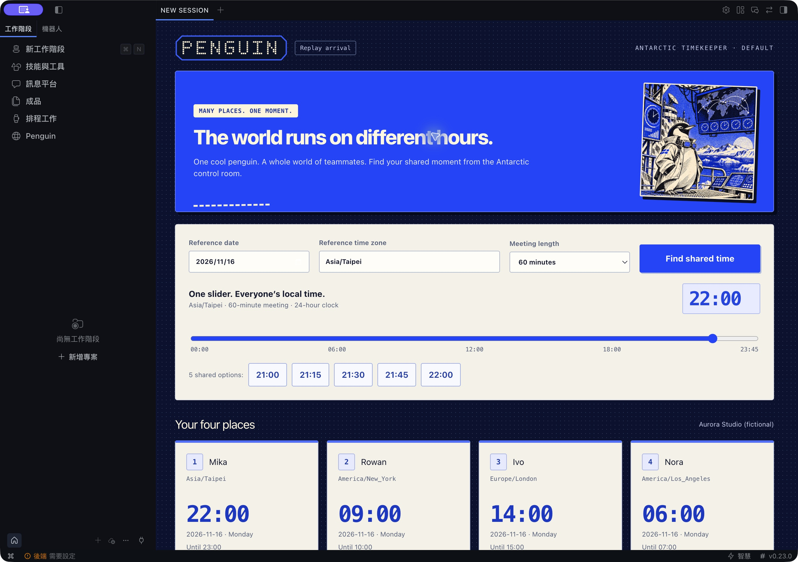
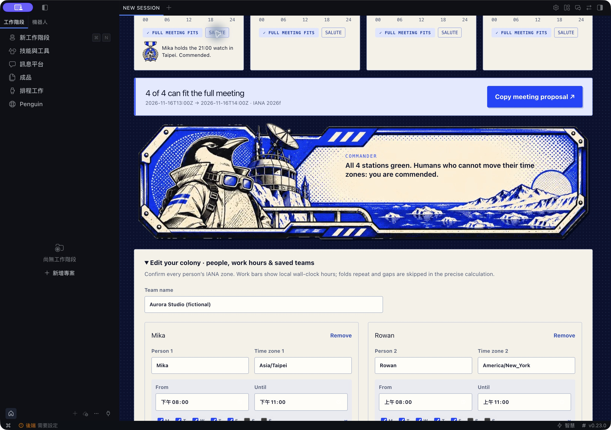

# Penguin 🐧

**A penguin in Antarctica, keeping an eye on everyone's time.**

0.2.2 adds a halftone aurora to the control-room sky. The number of people who fit the entire meeting sets its brightness and reach; optional music adds flow. **Polar Frequency**, AI-generated with MiniMax, starts only after Play. Pause, mute, zero volume, hidden/minimised pages, **Still sky** and system reduced motion rest the sky. Still sky keeps the music playing. The original arrival, **Skip intro**, commander dive, replay and four-clock planner remain.

Penguin 0.2.2 is listed in the [official Hermes Marketplace](https://hermes-agent.nousresearch.com/marketplace/penguin). Audio is not MIT: see [audio notice](assets/audio-lab/NOTICE.md) and [0.2.2 validation](docs/VALIDATION_0.2.2.md).

Penguin is a native Hermes Agent plugin for distributed teams: precise time conversion, meeting windows that fit the **whole** meeting, and saved team settings. Its optional Desktop page shows four people side by side with one shared time slider. Narrow screens use two columns and a horizontally scrollable timeline.

The electric-blue Antarctic control room uses Crystal's Penguin illustration and a crisp PENGUIN dot-matrix wordmark, with four clocks across on desktop and two columns on small screens. A 3.6-second arrival screen can be skipped or replayed; reduced-motion preferences disable its entrance animation. The Commander comments on the current meeting fit, and each clock has a SALUTE commendation. Successfully copying a meeting proposal shows an inline confirmation and a View send-off control, plus a dismissible APPROVED card, blue-white dot-matrix aurora and replayable penguin exit. The send-off says explicitly that no calendar event was created, and is cleared when the selection changes. It is a local UI animation, not a generated video, and plays no audio.



Captured from actual Hermes v0.23.0 with an isolated gateway and fictional team settings. The 0.2.0 artwork/UI branch was checked in the native app; integration follow-ups were checked in a disposable browser harness. Screenshot provenance and the exact distinction are in [validation notes](docs/VALIDATION_0.2.0.md). The backend needs-setup badge means no model provider is configured; Penguin does not require one. [Illustrated Antarctic arrival](docs/native-arrival-0.2.jpg).

## Install locally

Requires Python 3.11+ and **Hermes >=0.23.0**. Tested against official release commit `2bd378ed1b8d6bf2192cb26e0a55ff3091e6bd19`. Use a fresh development profile/home for the prototype. The `penguin` folder itself is the installable package; do not copy the surrounding workspace, references, environments or evidence.

From this package's directory, with Hermes on PATH:

```bash
# Set this to a NEW directory for your isolated test profile.
export HERMES_HOME="/absolute/path/to/penguin-demo-home"
mkdir -p "$HERMES_HOME/plugins"
# Refuse an accidental replacement of an existing install.
test ! -e "$HERMES_HOME/plugins/penguin" && cp -R . "$HERMES_HOME/plugins/penguin"
hermes plugins validate "$HERMES_HOME/plugins/penguin" --install-deps
hermes plugins doctor "$HERMES_HOME/plugins/penguin" --ci
hermes plugins enable penguin
hermes
```

For Desktop, connect the app to the same home/profile, enable Penguin's Desktop half in **Capabilities → Plugins**, and open **Penguin** in the sidebar. Restart the gateway after adding its backend. Desktop is opt-in. No installed user profile was changed while building this prototype. The standalone browser harness in the development workspace is a test preview, not a replacement for Hermes.

Native macOS verification used the unmodified official v0.23.0 source-built Electron app and an isolated gateway/home. The sidebar route, backend-loaded illustration, four clocks, shared suggestions, whole-meeting rejection, save/edit/load and repeated-hour choice were exercised in the real app. No model provider was configured in that test profile: Desktop works without an LLM, while conversational model-driven tool selection remains untested. Tool registration and calls were separately tested through the real Hermes PluginManager and registry.

## Interface typography and interaction

Brand specification: [English](docs/BRAND_GUIDELINES.md) · [繁體中文](docs/BRAND_GUIDELINES.zh-TW.md).

Changes, validation and distribution scope: [0.2.0 review notes](docs/RELEASE_NOTES_0.2.0.md) · [validation and limits](docs/VALIDATION_0.2.0.md).

0.2.0 adds an illustrated control-room arrival, a Commander dispatch line that commends teammates who cannot move their time zones, per-person `SALUTE` medals, an APPROVED stamp and a short exit in which the commander says “I’ll be back.” and dives. All of it is local, silent and non-blocking, and reduced motion is respected.

The original Penguin typography is retained: the Antarctic status line, availability badges, replay control and IANA zone labels keep their compact monospace character. The upper selected-time input now explicitly shares the clock cards’ numeral family, weight, tabular-number feature and tracking. The PENGUIN wordmark remains a drawn dot matrix. Fonts resolve locally through system font stacks; no commercial website fonts, trial font files or external font requests are bundled.

Moving the shared timeline starts a backend preview immediately. Previous clocks remain readable while an update is in flight, with an updating state and copying disabled; only the newest response is accepted. A stale clipboard result cannot display a completion for a new selection or another profile. The completion panel remains in the planner, is dismissible, respects reduced motion and does not autoplay audio. Separate narrated demo media is not part of this package.



## Four agent tools

| Tool | Purpose |
|---|---|
| `penguin_convert` | Resolve an explicit local date/time and convert it to other IANA zones. |
| `penguin_overlap` | Find full-duration common windows, using an inline team or saved `team_id`. |
| `penguin_save_team` | Save/replace a team when the user asks to remember it. |
| `penguin_get_team` | Read the team from the active Hermes profile. |

Representative `penguin_convert` call:

```json
{"local_time":"2026-11-16T21:00","source_zone":"Asia/Taipei","target_zones":["America/New_York","Europe/London","America/Los_Angeles"]}
```

Returns the same instant: Taipei 21:00, New York 08:00, London 13:00, Los Angeles 05:00, all on November 16. Every local result includes its date, UTC offset, weekday, DST indicator and repeated-hour `fold`.

Save the synthetic team in `examples/aurora-team.json` by passing it as `team`:

```text
penguin_save_team({"team_id":"aurora-demo","team":<contents of examples/aurora-team.json>})
penguin_get_team({"team_id":"aurora-demo"})
penguin_overlap({"team_id":"aurora-demo","reference_zone":"Asia/Taipei","start_date":"2026-11-16","days":1,"duration_minutes":60,"max_slots":5})
```

The first shared hour is **13:00–14:00 UTC**. The returned `common_windows` include short windows too, marked with `fits_duration`. `slots` contain only complete fits. Results are ordered earliest UTC first; the suggestion step starts at each common window. Truncation is explicit.

For an ambiguous hour:

```json
{"local_time":"2026-11-01T01:30","source_zone":"America/New_York","target_zones":["Asia/Taipei"]}
```

This returns `ambiguous_local_time` with **05:30Z and 06:30Z** candidates. Ask the user which occurrence they mean, then add `"ambiguity":"earlier"` or `"later"`. A nonexistent time such as `2026-03-08T02:30` returns `nonexistent_local_time`; Penguin never silently shifts it.

## Semantics and limits

- IANA **2026f**, from Python tzdata **2026.6**, is bundled as non-executable TZif data. Python `zoneinfo.ZoneInfo.from_file` reads those exact files. The host's timezone, locale, system database and clock do not choose results. No monkey-patching or global `TZPATH` change.
- Current database data, corresponding `tzdata.zi` source, licenses and per-file SHA-256 hashes live in `tzdb/`. This avoids a dependency conflict with Hermes's Windows pin on tzdata 2025.3. Updating these rules requires a reviewed plugin release, not a runtime downloader.
- Dates: 2000–2100; minute precision; up to 30 members, 8 windows per member, 14 search days, 480-minute meetings and 20 returned suggestions.
- Work windows use local wall-clock hours; Monday=0 through Sunday=6. End boundaries are exclusive; equal start/end is unavailable. Overnight windows use the shift's start weekday. Both occurrences of a repeated hour count as available when the local window covers them; gaps contain no real instants. Durations are measured in UTC.
- `UTC` and regional IANA names/aliases are accepted; ambiguous bare abbreviations such as `EST` are rejected. Confirm each person's city/zone rather than inferring it from a country.
- Calendar conflicts, holidays, travel, future rule changes, fairness ranking and shared team sync are outside this prototype. Saved teams hold preferences, not confirmed availability. Same-ID saves replace that team's entire settings; concurrent replacements of the same ID use last-write-wins.

## Privacy and public surfaces

Runtime makes **no external network calls**, launches no shell or background process, reads no credentials, and has no telemetry. It reads only its bundled files and its own profile-scoped plugin state. Agent tool inputs/outputs are visible to the active Hermes conversation/model as usual.

The Python entry point uses `ctx.register_tool`; persistence uses `ctx.state`. Desktop uses only `@hermes/plugin-sdk` and React: a route, sidebar navigation, plugin-scoped `ctx.rest` and explicit-gesture clipboard writes. Its FastAPI routes under `/api/plugins/penguin/` share the engine and `PluginState("penguin")`; Hermes supplies profile routing and authentication. Backend routes are `preview`, `convert`, `overlap`, `teams/save` and `teams/get`. Fixed, read-only `audio-lab/music` and `audio-lab/features` routes serve the bundled track and its offline frequency curves only after Play; they accept no paths, uploads or microphone input. The obsolete briefing audio/route is absent. Audio and its curves share the playback clock, rather than reacting to live microphone input. The read-only `art` and `art/kit` routes serve one fixed bundled PNG and four fixed WebP artwork files as data URIs through the same host bridge, with no arbitrary file path input. Successful art-kit loads are shared in memory; failed or incomplete loads are evicted so a later mount (for example Replay arrival) can retry. Artwork failure leaves CSS/SVG/text fallbacks usable; there is no background retry loop. The preview checks every minute of the selected meeting. No host functions, markup, stores or prototypes are patched. A connection/profile change clears the editor's transient data; stale responses are ignored.

## Tests

Use a separate development environment with pytest 8+:

```bash
python -m pytest tests -q
# Six additional real-state/API integration tests require an official Hermes checkout:
HERMES_SOURCE=/absolute/path/to/hermes-agent python -m pytest tests -q
```

Integration checks need Hermes's runtime dependencies plus FastAPI and httpx. Tests use temporary homes and fictional people. They cover DST gaps/folds, half-hour changes, skipped dates, international date boundaries, overnight weekday attribution, meeting duration, invalid input, deterministic output, data hashes, persistence, corruption preservation, concurrent distinct-team saves and profile isolation. `python -S` verifies the engine needs no installed third-party package.

Reproducible lab.3 model, actual WebAudio, loop/performance, completion and artwork recovery checks are in [tests/browser/README.md](tests/browser/README.md). Browser regressions are development-only and are not a native Hermes substitute. With an isolated loopback harness serving the actual component and Python API, run `playwright-cli run-code --filename tests/desktop-recovery.js` for outage recovery; run `node tests/desktop-completion.mjs` with Playwright available for completion visibility, narrow dates, reduced motion, clipboard failure and invalid input. The latter uses a disposable headless profile and a synthetic clipboard. `PENGUIN_TEST_URL` selects the loopback harness; `PLAYWRIGHT_CHANNEL=chrome` can use an installed Chrome. See [validation notes](docs/VALIDATION_0.2.0.md).

## Origin and licensing

The scheduling behavior and four-clock interaction evolve Crystal's earlier browser-based team time planner. That original checked one instant; Penguin adds a native agent API, full meeting checks, profile persistence and a shared Python backend. All fixtures and screenshots prepared for this package use fictional people. The original AI-generated illustration was supplied by Crystal and is bundled unchanged; the four-file control-room kit is resized/compressed artwork supplied for Penguin; the plugin has no music service or generated soundtrack dependency.

Penguin's code, tests and documentation are MIT-licensed; see `LICENSE`. The illustration is separately permitted for use and redistribution with Penguin and its demonstrations; see `assets/NOTICE.md`, `assets/kit/NOTICE.md` and `LICENSE_STATUS.md`. Bundled timezone data retains its upstream license notices in `tzdb/licenses/`. No ElevenLabs service or code is used; its official plugin was only a reference for supported Desktop surfaces.
